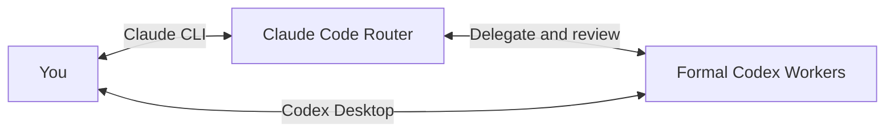

# CC–Codex Super Agent

**Claude Code harness as Router. Codex harness as Worker.**

An independent, rules-first collaboration workflow for people who use both tools: align intent with Claude Code, let it guide and review native Codex Workers, and intervene directly through Codex Desktop when useful.

Inspired by DeepSeek's *[Exploring Super-agent Design: Towards a More Autonomous Agent System](https://x.com/DeepSeekHarness/article/2116857257245987236)* and its [research prototype](https://github.com/deepseek-ai/dsh-superagent-prototype). This is our own Claude Code + Codex implementation of selected Router/Worker ideas. It has no DeepSeek, DSH or DSH+ runtime dependency and is not affiliated with those projects or a feature-equivalent port.

[中文说明](README.zh-CN.md) · [Setup](SETUP.md) · [Architecture](docs/architecture.md) · [Compatibility](docs/harness-compatibility.md) · [Roadmap](docs/roadmap.md)

## What the Router contributes

Claude understands intent, chooses a sensible task boundary, writes constraints, directs repairs, independently inspects evidence and delivers the result. It also personally performs Claude-assigned review/design/refinement. Small reversible actions can take a direct path.

Codex performs substantive execution in registered native sessions. Persistent Workers are reused; one-off ephemeral Workers stay out of the usual roster; existing personal sessions are adopted only when named by the person. You can talk to the Router or to a formal Worker. One shared project authority keeps both aligned.

This is useful when you have access to both harnesses, through your own eligible subscriptions or other supported setup. It does not supply accounts, change providers or promise particular models, plan allowances or cost savings.

## Talk to the Router or directly to a Worker



Use the Router for intent, planning, coordination and reviewed delivery. Use Codex Desktop to inspect or talk directly to the same persistent Worker, or create a personal chat of your own. One-off temps remain behind the Router; personal chats are managed only when you explicitly select them.

Shared history preserves continuity. For sustained human intervention, coordinate manual/pause control; the Router checks intervening changes and queued work before continuing. See [session ownership and control](docs/session-lifecycle.md).

## Native communication, bounded context

`ai-work` returns structured JSON. A local coordinator uses the existing Codex App Server's JSON-RPC thread/turn interfaces and events; it does not scrape terminals or simulate keyboard conversations.

Task results prefer the final answer; synchronization includes bounded incremental user/agent messages and can include public progress. The adapter does not forward reasoning items or raw tool-output streams to the Router. The Router still inspects files, diffs and test evidence when needed. Work packages and final deliverables remain text inside a structured lifecycle.

Incremental synchronization, event-driven wakeups and reusing session context are designed to avoid repeated history transfer and model polling. No token-saving percentage has been measured; Worker inference and Router acceptance still consume their respective usage. See [communication and optimization opportunities](docs/communication-and-sandbox.md).

## Try the source snapshot

Snapshot **0.3.0** includes the runtime, Router/Worker skills, an optional manual Pro-advisor skill, tests and reversible user installation. It targets Python 3.11+ on POSIX macOS/Linux. The native backend/control endpoint must already be available under the execution user; an ordinary CLI installation alone does not guarantee that endpoint.

```sh
git clone https://github.com/Kevin-Pal/cc-codex-super-agent.git CC-Codex_Super_Agent
cd CC-Codex_Super_Agent
PYTHONPATH=src python3 -m claude_codex_workflow.cli install --role both
# Review the preview, then apply:
PYTHONPATH=src python3 -m claude_codex_workflow.cli install --role both --apply
~/.local/bin/ai-work doctor
```

Start Claude Code in your project directory, load `/claude-codex-router`, and describe your goal. In Codex Desktop, attach the same execution host/user/project path to open the persistent Workers or your own chats.

Continue with [SETUP.md](SETUP.md) for native-endpoint checks, doctor, Claude reload, optional advisor installation and rollback. Install from a Git checkout or source archive; wheel/PyPI installation is not supported in this snapshot.

Run the project entry directory, Claude CLI, Codex backend and framework on one execution host/user. Access it locally, or use SSH/tmux for Claude and native Codex Desktop Remote from another computer. The access-only computer needs no framework installation. The actual task target can be elsewhere.

Trusted Workers deliberately use broad native permissions with approvalPolicy=never. Use them only for work you authorize and trust; an independent-review template is read-only. The coordinator is not an OS security boundary and does not protect arbitrary unmanaged sessions or shared remote resources.

## Evidence and limits

The 0.3.0 implementation has been checked with Claude Code 2.1.316 and native Codex 0.166.0: Mac/Linux isolated regressions, a real isolated temp and checked cleanup, and same-ID project-entry reload probes. Public distribution checks, earlier Desktop Remote evidence and remaining limits are recorded in [validation](docs/runtime-validation.md). Do not infer all platform/GUI/model combinations are validated.

Managed temp worktree preparation and checked cleanup are implemented. Same-tree writes currently queue. Automatic branch integration, structured question/approval forwarding, configurable concurrency and richer token metrics remain future work. Long-running tasks beyond the current wakeup window may need a later user turn or inbox check. Ephemeral sessions do not promise reconnection recovery.

The [conversation API guide](docs/worker-interaction.md) separates current capabilities from the unshipped 0.4.0 candidate.

## Design and contribution

- [Router accountability](docs/router-accountability.md), [Claude direct work](docs/claude-direct-work.md), [session lifecycles](docs/session-lifecycle.md).
- [Shared memory](docs/project-memory.md), [prompt design](docs/router-prompts.md), [design decisions](docs/design-decisions.md), [harness rationale](docs/router-harness-rationale.md).
- [DeepSeek study](docs/deepseek-superagent-study.md), [parallel Worker proposal](docs/parallel-workers-design.md), [optional Pro advisor](docs/human-advisor.md).
- [Contributing](CONTRIBUTING.md), [reviewed snapshot policy](docs/snapshot-workflow.md), [MIT license](LICENSE), [acknowledgments](NOTICE.md).

```sh
PYTHONPATH=src python3 -m unittest discover -s tests
python3 tools/check_publication.py --history
```

Private deployment configuration, raw conversations, credentials, personal project memories and internal provider maintenance are outside this repository. Updates arrive as reviewed snapshots, not an automatic mirror of an operator's private development history.
