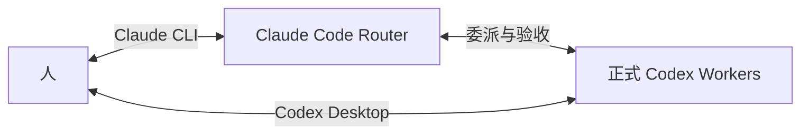

# CC–Codex Super Agent

[English](README.md)

**Claude Code harness 做 Router，Codex harness 做 Worker。**

面向同时熟悉或使用两种 harness 的人：你与 Claude 对齐目标，Claude 写约束、调度与验收 Codex；需要时直接在 Codex Desktop 与正式 Worker 对话。可以使用你自己符合条件的订阅或其他原生配置；项目不提供账号、不管理供应商、不保证特定套餐额度。

灵感来自 DeepSeek 的 *[Exploring Super-agent Design: Towards a More Autonomous Agent System](https://x.com/DeepSeekHarness/article/2116857257245987236)* 和 [研究原型](https://github.com/deepseek-ai/dsh-superagent-prototype)。本项目独立实现其中适合 CC–Codex 协作的 Router/Worker 思路，不依赖 DeepSeek、DSH 或 DSH+ 运行时，不代表官方关联或完整功能复刻。我们有意让 Router 承担理解、指导、交叉核验和最终加工。

[English](README.md) · [文档索引](docs/README.md) · [安装](SETUP.md) · [架构](docs/architecture.md) · [版本兼容](docs/harness-compatibility.md) · [后续方向](docs/roadmap.md)

## 为什么这样分工

Claude 亲自承担规划、关键判断、验收和交付；用户点名 Claude 的美化、设计或核验也由它完成。常规实质执行默认交给 Codex；低风险微任务可以直接做。Worker 不足时 Router 要提供具体诊断和增量指导，不能只原样转发。

正式 Worker 按长期方向续用原生会话；一次性 temp 不进入日常名单；用户自建 session 只有被点名后才接管。人既能和 Router 交互，也能在 Desktop 中观察、纠偏正式 Worker。项目知识共用 AGENTS.md 和权威状态文档，不另维护三份事实库。

## 人既能找 Router，也能直接找 Worker



通过 Router 对齐意图、规划、协调并获得验收后的交付；通过 Codex Desktop 观察或直接指挥同一个正式 Worker，也可以自建个人会话。一次性 temp 由 Router 管理，个人会话只有被你点名时才进入框架的管理流程。

共享历史让上下文能够延续。持续人工接手时先协调 manual/paused 控制，Router 接回时检查人的新决定与旧队列，再继续工作。详见[会话归属与控制](docs/session-lifecycle.md)。

## 底层通信与上下文

`ai-work` 输出 JSON，协调器通过本地 socket 和原生 App Server JSON-RPC 的 thread/turn/事件接口工作，不依赖截图、按键模拟或人工搬运结果。工作内容仍以文本为主，身份、状态、同步位置和完成事件是结构化数据。

`result` 优先取最终答复；`sync` 返回有预算的增量输入与 agentMessage，可能包含公开进度。适配器不向 Router 转交 reasoning 项或原始工具输出流。Router 按需读文件、diff 和测试证据验收；最终答复不自动等于信息充分或任务通过。

事件唤回、会话复用和增量同步旨在减少轮询、重复背景及历史搬运。尚未测量节省比例，Worker 自身推理和 Router 验收照常产生用量。详见 [通信与可优化方向](docs/communication-and-sandbox.md)。

## 使用

当前公开源码 `0.3.0` 包含运行层、两端技能、可选手动 Pro 顾问和可回滚安装器。需要 Python 3.11+、POSIX macOS/Linux、同一执行用户下可用的原生 Codex 后端/control socket；仅装 CLI 不保证有该端点。按 [SETUP.md](SETUP.md) 先预览再安装。当前支持 Git checkout/源码归档安装，尚不支持 wheel/PyPI 分发。

```sh
git clone https://github.com/Kevin-Pal/cc-codex-super-agent.git CC-Codex_Super_Agent
cd CC-Codex_Super_Agent
PYTHONPATH=src python3 -m claude_codex_workflow.cli install --role both
# 查看预览后再安装：
PYTHONPATH=src python3 -m claude_codex_workflow.cli install --role both --apply
~/.local/bin/ai-work doctor
```

在项目目录启动 Claude Code 并加载 `/claude-codex-router`；在 Codex Desktop 打开同一执行设备、用户和项目路径，查看正式 Worker 与个人会话。只有访问端的电脑无需另装框架。

执行端承载项目入口、Claude CLI、Codex 后端和框架。人可以就在执行端，也可以通过 SSH/tmux 与 Codex Desktop Remote 访问；访问端无需再装框架。任务实际操作的目标可以在别处。

trusted-worker 使用较宽原生权限和 approvalPolicy=never，必须有具体授权与验收；只读复核可用 independent-review。框架不是 OS 隔离，未纳管会话、任意 Bash 写入及外部共享资源仍需协调。

Linux执行端＋Mac Desktop Remote 的基础流程已试点；Mac/Linux隔离回归覆盖不等于所有原生组合都验收。已测版本、temp重连/45分钟唤回窗口等限制见 [验证](docs/runtime-validation.md)。0.3.0 已实现 temp worktree 准备与受保护的回收，同树写任务仍排队；自动分支集成、结构化问答桥等继续 TBD。

[会话交互接口](docs/worker-interaction.md)区分现行能力与尚未发布的 0.4.0 候选；完整组件和架构图见[专章](docs/framework-components.md)。

MIT许可。私有实例的供应商/认证/隐私配置、原始聊天、真实项目记忆和内部维护不进入此库；后续只接收经过审查的阶段快照。
