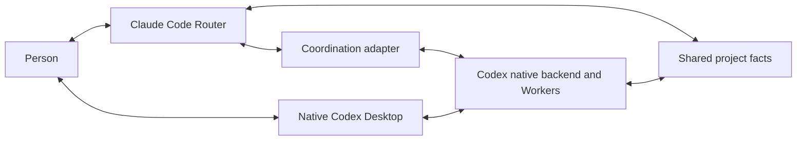
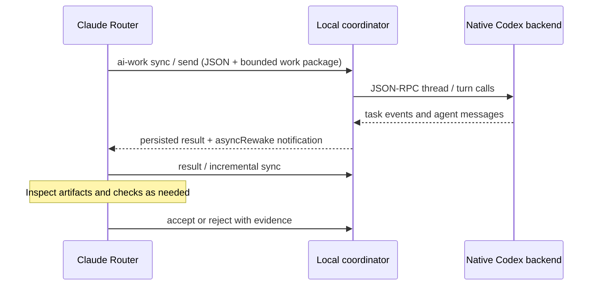

# Architecture and authority

The person aligns with a Claude Code Router. The Router turns intent into a bounded work package, dispatches Codex Workers, inspects evidence, requests repairs and presents the result. The person can also directly talk to a formal Worker.

The coordinator owns deterministic identity, task state, synchronization and notification. It does not replace either harness. The access GUI uses the native remote connection instead of a second custom Worker UI.

Temporary tasks, persistent formal Workers and explicitly adopted personal sessions have distinct lifecycles. Continue the registered native thread for an existing workstream. A shared conversation view is not a writer lock: check active turns, synchronize new human input and preserve manual/paused control.

One project authority is sufficient: `AGENTS.md` and linked domain/state documents. A thin `CLAUDE.md` may import that entry. Native memories and conversation context supplement project facts rather than becoming divergent project authorities.

Router token savings come from concise work packages, asynchronous waiting and incremental returns. Temporary threads do not inherently discount Router usage. Ask for artifacts, decisions and observable checks; do not require private chain-of-thought.

Current working-mainline experience includes structured native App Server threads, turns and completion events. The source snapshot includes that adapter. Structured question/approval routing is a later optional iteration, not an implemented feature of this snapshot.

## Native lifecycle, selective text

The adapter uses structured identities, lifecycle events and errors. Task content is still mainly text; result extraction prefers final_answer and falls back to the last agent message when that phase is absent. The task record also contains the submitted work package. Incremental sync may include public progress but filters reasoning and raw tool-output items from its model-facing view. This is an adapter behavior, not a claim that all backend reasoning is inaccessible to every tool or that a Worker cannot write an explanation in its final answer.

Event-driven waiting and bounded transfer aim to reduce unnecessary Router context and polling. They do not eliminate the Worker's own inference, prove an exact saving percentage, or make a final answer sufficient evidence. See [communication](communication-and-sandbox.md) for optimization opportunities.
