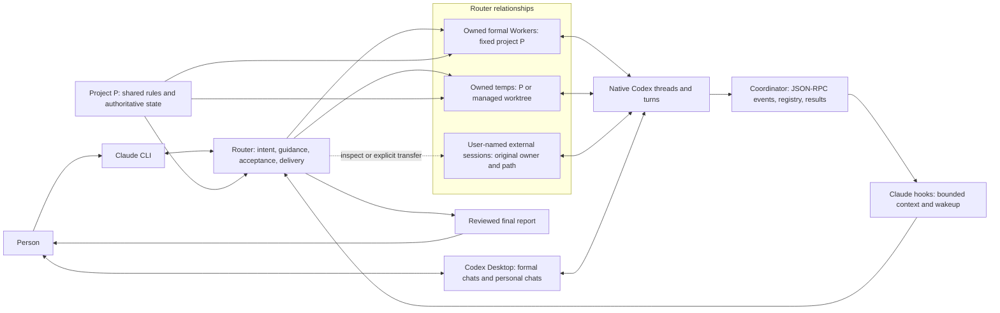

# Framework components and session views

The framework is a small rules-and-runtime distribution, not just a memory edit, skill or alias. It installs on the execution host/user; native Desktop Remote and SSH/tmux remain the person's access layer.

The two human-facing chat types are persistent formal Workers and human-created personal sessions. A user-named external formal Worker is still a formal Worker, not a fourth native type. Temp chats are ephemeral; their result, evidence and acceptance reach the person through the Router. Desktop directly accesses the same native persistent thread; it is not a copied Router transcript. Project and Recents grouping have version-dependent limits.

The Router receives structured identity/status/events, bounded public message increments and final-answer-first results. Reasoning items and raw tool-output streams are not forwarded as Router context. Files/diffs/tests remain evidence the Router must inspect as needed. No fixed token-saving percentage is asserted.

## Installed or maintained components

| Component | Purpose | Persistent change |
| --- | --- | --- |
| Short Claude/Codex entries | Role and authority discovery | Owned marked blocks in global CLAUDE.md and Codex instruction source; existing agents-sync source chain is used when present |
| Router and Worker skills | On-demand creation, continuation, review and execution guidance | Links to versioned skills; supporting guides stay in the release |
| Optional Pro advisor skill | Explicitly chosen manual web consultation | Optional installation, no automatic browser/clipboard operations |
| `ai-work` CLI | Validated JSON commands for humans/hooks/Router | Executable launcher; not merely an alias |
| Coordinator and SQLite registry | Ownership, queues, locks, sync, results, review and recovery | One execution-user state root; local control socket, no public TCP listener |
| Native RPC adapter | Connect to existing Codex App Server | Uses native thread/turn IDs, events and existing authentication; does not copy credentials |
| Claude command hooks | Register/freeze project entry, supply concise context, guard named tools, wake an idle Router | Owned entries in five hook events; unrelated hooks/settings preserved |
| Managed temp workspaces | Optional checkout isolation and checked cleanup | Project namespace below; local Git exclusion; explicit resource receipts |
| Installer/rollback | Versioned source bundle and reversible integration | Content-hashed release, current link and private install manifest |

The five hook events are SessionStart, UserPromptSubmit, PreToolUse, PostToolUse and Stop. Path identity, creation permissions, dispatch conflict checks and cleanup eligibility are enforced in coordinator code. Hooks trigger integration and add context; prompts carry semantic goals, scope and acceptance. Arbitrary Bash writes are not fully intercepted by the named-tool guard.

No native Claude Agent Teams/nested-session runtime, DSH dependency, extra model endpoint or custom human chat UI is required. `codex-tier`, SSH/tmux, provider managers and access-side Desktop are separate optional/environment tools; they are not aliases supplied by this public framework.

## Locations and what belongs there

| Location | Contents | Lifecycle |
| --- | --- | --- |
| Project `.claude/cc-codex-super-agent/` | Temp worktrees and project resource receipts | Owned task resources; explicit checked cleanup, locally excluded from Git |
| `~/.local/share/claude-codex-workflow/releases/` and `current` | Versioned runtime, rules, skills and docs | Installer-managed code; retained rollback releases |
| `~/.local/state/claude-codex-workflow/` | Coordinator DB, control socket, logs, manifests/backups | Private execution-user state, independent of individual project paths |
| `~/.claude/` / `~/.agents/` / `~/.codex/` | Native instruction entry and skill links; existing native sessions/config | Update only owned integration; native history/auth stays with the native tools |

`CCW_HOME` selects the execution-user state root where needed. The compatibility names of installed module/state directories are intentional; the public repository/display name is CC–Codex Super Agent. Consolidating project execution resources does not mean putting accounts, provider settings, every chat log or the cross-project database inside a Git project. A future plugin package may use its platform data/cache conventions; no state is written into an installed plugin's version directory.

## Why this design

- One intentional project entry lets people attach one path and gives a formal team one shared rules/state authority. Filename responsibility is a task boundary; it should not fragment long-lived sessions into new projects.
- Formal sessions optimize continuity and human intervention. Temps optimize bounded independent execution and optional isolation. Changing the task's execution target need not create another permanent chat.
- External sessions retain their existing owner, knowledge and project identity; explicit collaboration/takeover is different from growing this Router's team.
- Human access, native session lifetime, framework registration and task acceptance are separate. Finishing work does not delete a formal Worker; deleting a checkout does not stop or delete a native session.
- Deterministic invariants belong at authoritative program boundaries. Model judgment still decides task decomposition, whether isolation helps, guidance and acceptance.
- Shared files plus freshness checks synchronize project facts; shared live conversation history preserves one Worker's context. Neither automatically synchronizes every model's already-loaded context.

Full ownership, constraints, conflict handling and cleanup are in [project paths](project-paths.md). Existing native evidence and limitations are in [validation](runtime-validation.md); source/installation/daemon versions are tracked separately in [versioning](versioning.md).
